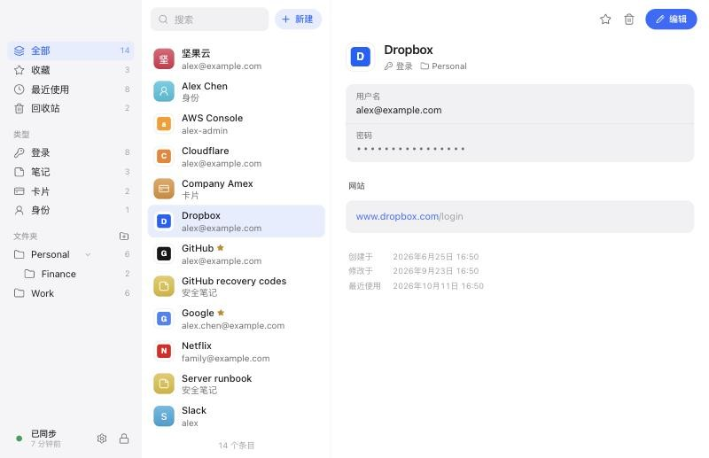
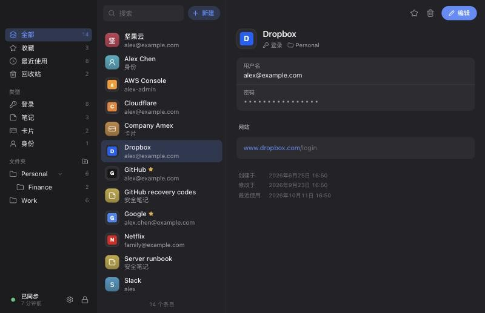

# Vaultlet

English | [简体中文](README.zh-CN.md)

A local-first password manager: a serverless alternative to Bitwarden.

- The vault is a standard **KDBX 4** file (Argon2id + AES-256), compatible with KeePassXC / Strongbox / KeePassium / KeePassDX, so on mobile you can use those clients directly.
- Sync across devices through your own cloud drive: put the vault in an iCloud Drive / Dropbox / OneDrive folder, or use a WebDAV server (e.g. Nutstore). Conflicts are merged per entry by timestamp.
- Desktop app: Tauri 2 + React, for macOS / Windows / Linux.
- Browser extension: Chrome / Edge / Brave / Firefox. It talks to the desktop app over Native Messaging; keys never leave the desktop process.
- Imports Bitwarden exports (JSON / CSV / password-protected JSON), with TOTP support.

| Light | Dark |
|---|---|
|  |  |

## Layout

| Path | Contents |
|---|---|
| `crates/vault-core` | Core library: KDBX read/write, data model, import, TOTP, URL matching, merge, WebDAV |
| `crates/vault-cli` | Debugging CLI |
| `crates/vault-ipc` | Socket naming and frame format shared by the desktop app and the native host |
| `crates/native-host` | Browser native messaging host (a pure proxy) |
| `apps/desktop` | Tauri desktop app (`src/` frontend, `src-tauri/` backend) |
| `apps/extension` | Browser extension |
| `docs/ARCHITECTURE.md` | Architecture and interface contracts |

## Usage

### Desktop app

```bash
cd apps/desktop && pnpm install && pnpm tauri:dev
```

On first launch, choose where the vault lives (a local folder, a detected iCloud Drive / Dropbox / OneDrive folder, or WebDAV) and set a master password.
Then pick a Bitwarden export (`.json` / `.csv` / password-protected `.json`) under Settings → Import.

To build installable packages: `pnpm tauri:build` (output in `target/release/bundle/`; on Windows this produces an `.msi` and an NSIS `-setup.exe`). Build paths and the builder's user name are stripped from the release binaries.

Building on Windows requires Rust (MSVC toolchain) and Visual Studio / Build Tools with the "Desktop development with C++" workload. The WebView2 runtime ships with Windows 11.

### Browser extension

1. In the desktop app, open Settings → Browser integration, tick your browsers and click Apply (this installs the native messaging manifests).
2. Run `cd apps/extension && pnpm install && pnpm build`, then load the unpacked extension in your browser:
   `apps/extension/dist/chrome` for Chrome / Edge / Brave, `apps/extension/dist/firefox/manifest.json` for Firefox.
3. Click the extension icon → "Connect to Vaultlet" and approve the pairing in the desktop app.

### Command line

```bash
cargo run -p vault-cli -- import-bitwarden ~/Vaultlet.kdbx ~/Downloads/bitwarden_export.json
cargo run -p vault-cli -- ls ~/Vaultlet.kdbx
cargo run -p vault-cli -- totp ~/Vaultlet.kdbx GitHub
```

The master password comes from `--password`, the `VAULTLET_PASSWORD` environment variable, or an interactive prompt.

### Turning real data into test data

```bash
python3 -I scripts/sanitize-bitwarden.py <export directory> <output directory>
```

Standard library only, no network access. Every value is replaced while the structure is kept (item types, field combinations, URL shapes, folder hierarchy, TOTP formats).

## Development

```bash
# Core library and CLI
cargo test -p vault-core
cargo run -p vault-cli -- --help

# Desktop backend end-to-end tests (Tauri mock runtime, no window)
cargo test -p vaultlet

# Desktop app
cd apps/desktop && pnpm install && pnpm tauri dev

# Browser extension
cd apps/extension && pnpm install && pnpm build   # output in dist/chrome and dist/firefox
```
